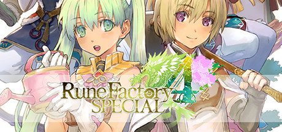

**Rune Factory 4: Special follows an amnesiac protagonist governing Selphia and uncovering ancient secrets through farming, dungeon exploration, crafting, and romance. Features the most polished and content-rich Rune Factory experience released on PC.**

---

## 📖 About

Rune Factory 4: Special follows an amnesiac protagonist governing Selphia and uncovering ancient secrets through farming, dungeon exploration, crafting, and romance. Features the most polished and content-rich Rune Factory experience released on PC.

## ⚠️ Problems Without Trainer

| Problem | Status |
|---------|--------|
| **Item Level Scaling** — Using wrong level equipment in higher difficulty areas is immediately lethal | ✅ Solved |
| **Orders Management** — Managing all town resident requests simultaneously requires organization | ✅ Solved |
| **God Artes Requirements** — Unlocking final skills requires completing specific hidden conditions | ✅ Solved |
| **Post-Game Dungeons** — Arc 3 and bonus dungeons are dramatically harder than main story | ✅ Solved |

## ✅ Solution

The **Rune Factory 4 Trainer** solves all these issues by giving you complete control over the game.

## 🎯 Full Feature List

- Unlimited Resources
- God Mode / Invincibility
- Instant Skill Cooldown
- One-Hit Kill
- Freeze Game Timer
- Unlock All Items & Achievements
- Custom Speed Multiplier
- Save State Anywhere

## 🚀 Quick Start

1. **Disable Windows Defender** temporarily (trainer may trigger false positive)
2. Download the trainer from the button above
3. Launch Rune Factory 4
4. Run the trainer as Administrator
5. Activate desired cheats with hotkeys

## 💎 Free vs Paid

| Feature | Free | Pro |
|---------|------|-----|
| Basic God Mode | ✅ | ✅ |
| Unlimited Resources | ✅ | ✅ |
| All Advanced Cheats | ❌ | ✅ |
| Auto-Updates | ❌ | ✅ |
| Priority Support | ❌ | ✅ |

## 💻 Requirements

- Windows 10/11 (64-bit)
- Rune Factory 4 (any version)
- .NET Framework 4.8+
- DirectX 11+

## 🍎 macOS

macOS users can use our alternative tool:

## ⚖️ Legal

This trainer is for educational and single-player use only. Use responsibly.

---

